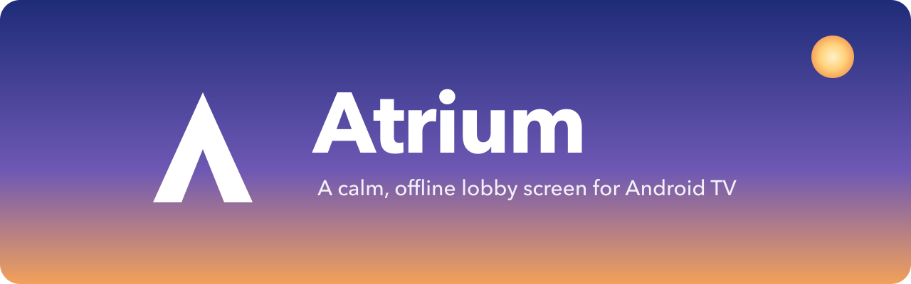
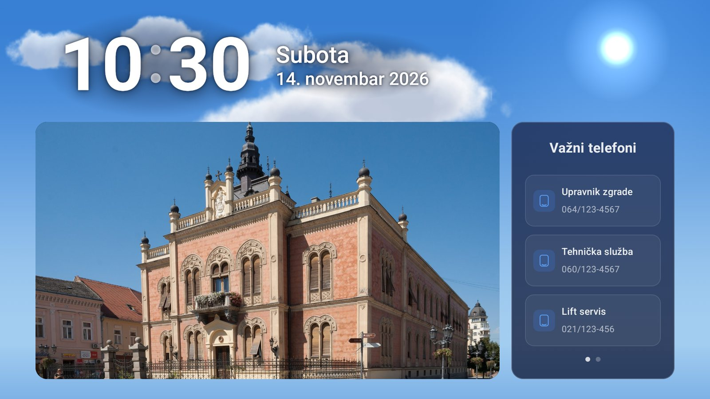
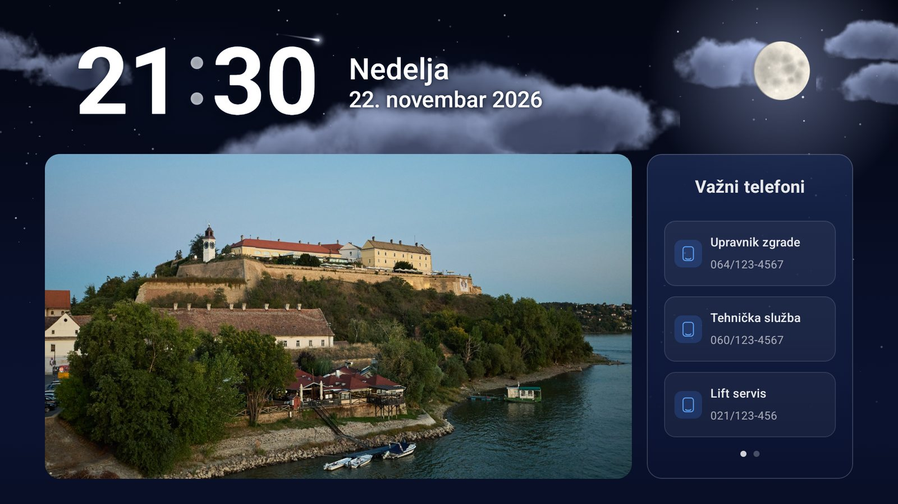
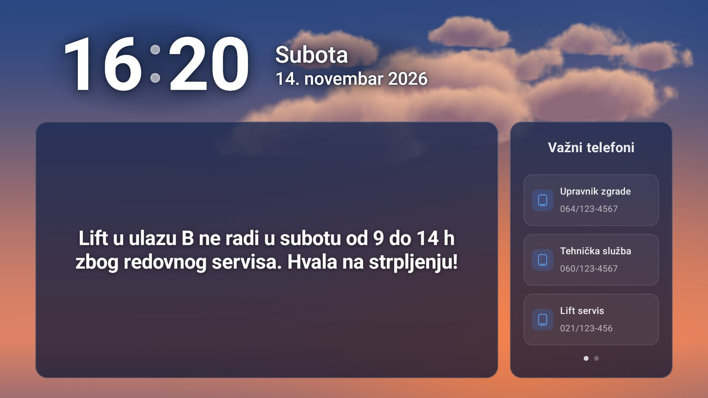
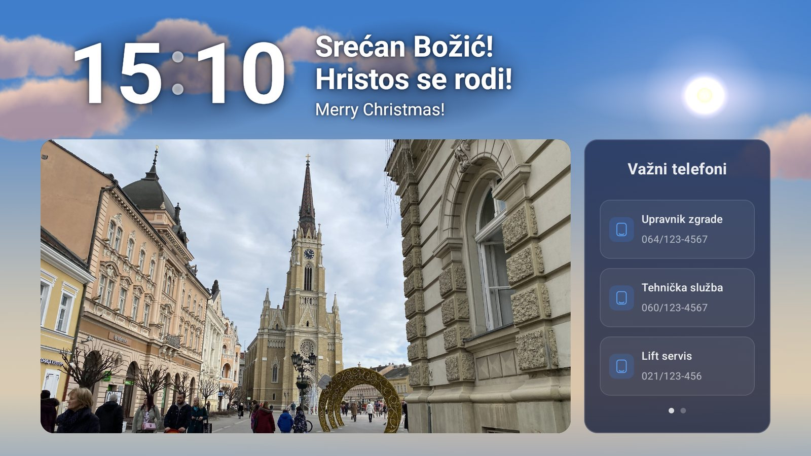
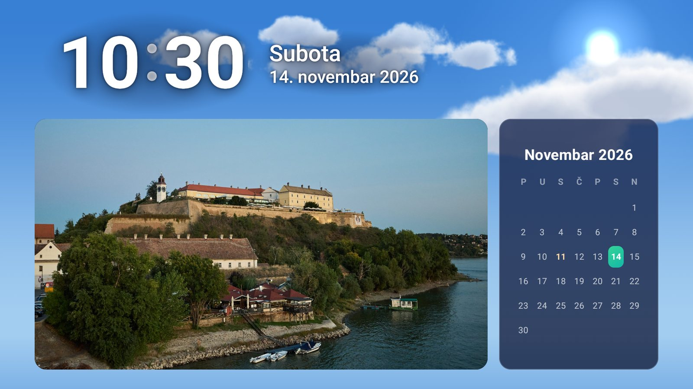
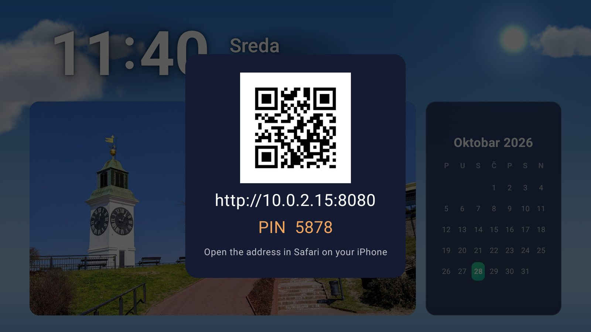
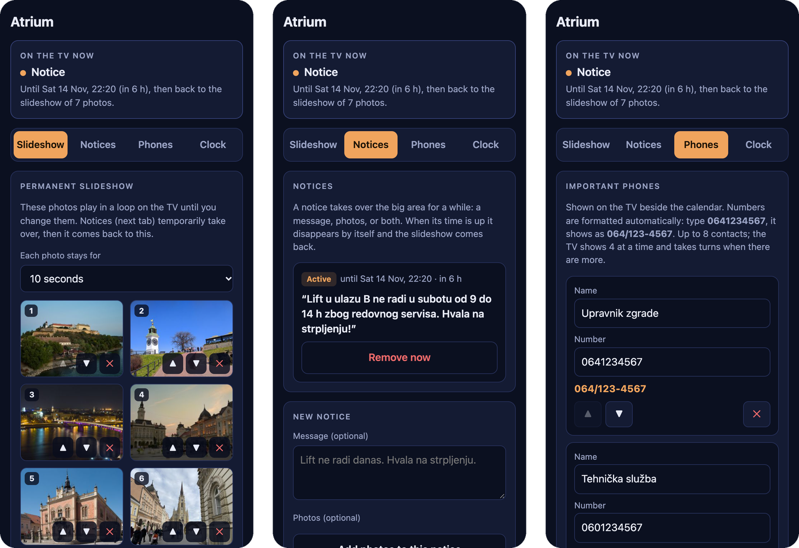
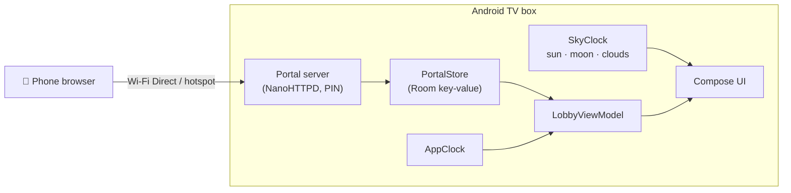

<p align="center">
  
</p>

<p align="center">
  
  
  
  
  
</p>

**Atrium** turns any cheap Android TV box into a lobby screen for an apartment building. It shows a live sky that follows the real sun and moon, a big clock, a calendar, important phone numbers, a photo slideshow and notices for the residents.

It needs no internet, no account and no cloud. The TV broadcasts its own Wi-Fi network, and the building manager runs everything from a phone: scan the QR code on the TV, enter the PIN, post a notice.

<p align="center">
  
</p>

## Features

**A sky window that is never the same twice.** The top bar is a window onto a sky computed for the screen's location. Sunrise, sunset and moon phase come from astronomical formulas, so the colours follow the real time of day: blue mornings, orange dusks, and starry nights with the actual moon phase and an occasional shooting star. Clouds are drawn in code and drift slowly across.

| Night | Dusk, with a notice |
|---|---|
|  |  |
| **Holiday greetings** | **Calendar and slideshow** |
|  |  |

- **Notices.** A notice takes over the big area for as long as you choose: an hour, until tonight, or until a set date. It can be text, photos, or both, can be scheduled to start later, and removes itself when it ends.
- **Slideshow.** Upload photos from the phone, reorder them, and choose how long each one stays on screen. A USB stick plugged into the box takes over the slideshow while it's in.
- **Important phones.** Up to 8 contacts (building manager, lift service, emergency numbers), four at a time, taking turns with the calendar.
- **Holidays.** Serbian public holidays, including Orthodox Easter, are computed offline and greeted in Serbian and English.
- **Its own clock.** Cheap TV boxes forget the time when the power goes out. Atrium remembers the last known time, notices when the system clock jumps, and lets you set the time from the phone without touching system settings.
- **Built for kiosk use.** Atrium starts on boot, can be the box's home screen so it comes back after a power cut, keeps the screen on, keeps content inside the TV's overscan area, and doesn't let the BACK button leave the app.

## Manage it from your phone

Press **OK** on the remote and the TV shows how to connect. On boxes with Wi-Fi Direct the TV runs its own network: the first QR code joins it, the second opens the portal. Elsewhere the portal is reachable on the box's hotspot or local network.

<p align="center">
  
</p>

The portal is a single page served by the TV itself. It works in any phone browser and is protected by a 4-digit PIN. After repeated wrong PINs it locks for longer and longer.

<p align="center">
  
</p>

## Getting started

### Requirements

- An Android TV device, Android 6.0 (API 23) or newer. Developed on inexpensive Android 9 and 10 TV boxes and the Android TV emulator.
- Android Studio, or JDK 17 and the Android SDK, to build.

### Build and install

```bash
git clone https://github.com/dulle88/lobby-app.git atrium
cd atrium
./gradlew assembleDebug
adb install app/build/outputs/apk/debug/app-debug.apk
```

Open **Atrium** from the TV's app list. To make it come back by itself after a power cut, set it as the home app when Android asks, or under *Settings › Apps › Default apps › Home*. On Android 10 boxes, also allow *Display over other apps* so it can start on boot.

On first run the slideshow is filled with a few bundled photos of Novi Sad. Delete them from the portal once you've added your own.

### Release builds

The release build is signed when a `keystore.properties` file exists in the project root (it's in `.gitignore`):

```properties
storeFile=app/release.keystore
storePassword=…
keyAlias=…
keyPassword=…
```

Without it, `./gradlew assembleRelease` produces an unsigned APK.

## Configuration

Set the screen's location in `gradle.properties`. It drives sunrise, sunset and the moon, and the time zone of the clock, notices and portal:

```properties
atrium.latitude=45.2517
atrium.longitude=19.8369
atrium.timeZone=Europe/Belgrade
```

Everything else (PIN, photos, slide duration, notices, contacts, clock) is set at runtime from the portal and stored on the TV.

> [!NOTE]
> Atrium was built for a building in Novi Sad, Serbia. The TV labels are in Serbian (Latin script), the holiday calendar is the Serbian one, and phone numbers are formatted the Serbian way (`064/123-4567`). These live in `util/HolidayCalendar.kt`, `util/PhoneFormat.kt` and the UI components, and are easy to adapt.

## How it works



| Package | What's inside |
|---|---|
| `portal/` | The embedded web server, its API and PIN lockout, the notice and contact rules, the Wi-Fi Direct group |
| `sky/` | Sun and moon positions (NOAA formulas), moon phase texture, procedural clouds, the sky palette and motion |
| `ui/` | Compose screens and components: the sky background, clock bar, slideshow, notice player, calendar and phone panel |
| `util/` | `AppClock` (time that survives power cuts), holiday calendar, phone formatting, USB media scanning |
| `data/` | Room database for slideshow photos and a small key-value table for settings |

The sky uses an AGSL shader on Android 13+ and a Canvas fallback with the same layers on older boxes. The web page lives in `app/src/main/assets/portal/index.html`, with no build step and no dependencies.

## Tests

```bash
./gradlew test
```

166 unit tests cover the portal API and PIN lockout, notice scheduling, the clock's power-cut handling, sunrise and sunset against NOAA reference values, the holiday calendar, and cloud and moon rendering.

## Credits

Default slideshow photos are from Wikimedia Commons, resized for TV:

| # | Subject | Author | License |
|---|---|---|---|
| 1 | [Petrovaradin Fortress above the Danube](https://commons.wikimedia.org/wiki/File:Gornja_i_donja_Petrovaradinska_tvr%C4%91ava_sa_podgra%C4%91em_-_Petrovaradin_Fortress_01.jpg) | BojanPavlukovic | [CC BY-SA 4.0](https://creativecommons.org/licenses/by-sa/4.0) |
| 2 | [Petrovaradin Fortress clock tower](https://commons.wikimedia.org/wiki/File:Gyssiikxescj.jpg) | Imeao | [CC0](https://creativecommons.org/publicdomain/zero/1.0/) |
| 3 | [Varadin Bridge and Novi Sad at night](https://commons.wikimedia.org/wiki/File:Varadin_bridge_and_Novi_Sad_from_Petrovaradin_Fortress_4.jpg) | Skelanard (Aleksandr Petukhov) | [CC BY-SA 4.0](https://creativecommons.org/licenses/by-sa/4.0) |
| 4 | [Freedom Square with the City Hall](https://commons.wikimedia.org/wiki/File:Trg_Slobode,_Novi_Sad.jpg) | Dragan Maksimovic | [CC BY-SA 3.0](https://creativecommons.org/licenses/by-sa/3.0) |
| 5 | [Bishop's Palace](https://commons.wikimedia.org/wiki/File:Vladi%C4%8Danski_dvor,_Novi_Sad.jpg) | Ludovic Péron | [CC BY-SA 3.0](https://creativecommons.org/licenses/by-sa/3.0) |
| 6 | [Name of Mary Church](https://commons.wikimedia.org/wiki/File:Name_of_Mary_Church,_Novi_Sad_2.jpg) | Vacant0 | [CC BY-SA 4.0](https://creativecommons.org/licenses/by-sa/4.0) |
| 7 | [Zmaj Jovina street](https://commons.wikimedia.org/wiki/File:Novi_Sad_2022,_Zmaj_Jovina_street_01.jpg) | Imeao | [CC0](https://creativecommons.org/publicdomain/zero/1.0/) |

The photos keep their own licenses. The phone numbers in the screenshots are made up.

## License

The code is released under the [MIT License](LICENSE).
